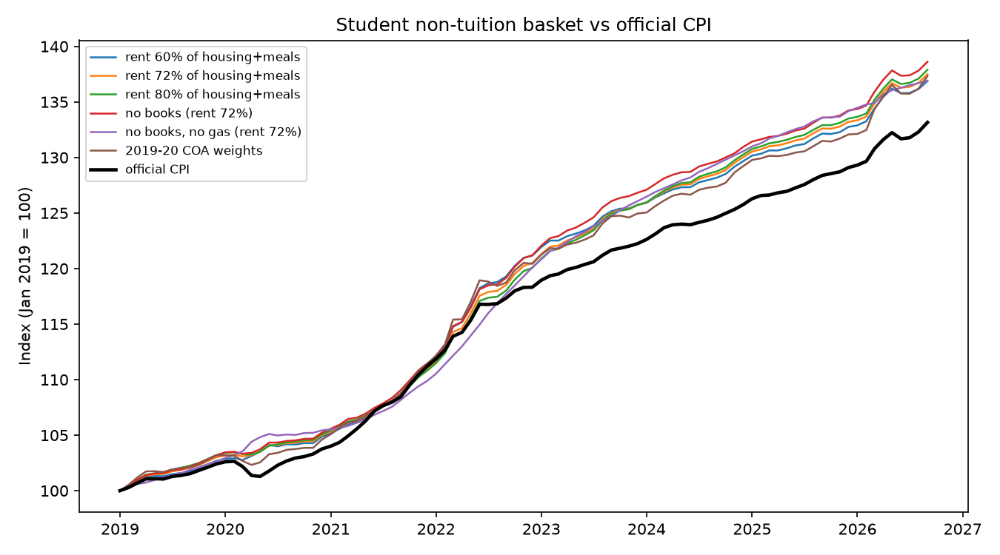

# Student CPI: has non-tuition inflation for a UW-Madison student outpaced official CPI?

**Question:** Since January 2019, has the cost of a basket built around a college student's non-tuition budget (rent, food, gasoline, books) risen faster than official CPI, and which component explains the difference?

**Finding:** In the baseline scenario, a student basket weighted from UW-Madison's cost of attendance rose about 37% from January 2019 to September 2026, versus about 33% for official CPI. The gap (roughly 3 to 5 index points) is positive in all six weighting scenarios I tested and does not depend on gasoline. Rent is the main driver. **This excludes tuition**, which rose far less than CPI (see Limitations).

## Data

All series are from FRED (St. Louis Fed), monthly, seasonally adjusted, January 2019 to September 2026.

| Component | FRED series | Notes |
|---|---|---|
| Rent | CUSR0000SEHA | CPI rent of primary residence, U.S. city average |
| Food | CUSR0000SAF11 | CPI food at home, U.S. city average |
| Gasoline | CUSR0000SETB01 | CPI gasoline (all types), U.S. city average |
| Books | CUSR0000SEEA | CPI educational books and supplies (broader than college textbooks, includes K-12) |
| Benchmark | CPIAUCSL | CPI all items, all urban consumers |

## Method

1. Rebase every series to January 2019 = 100.

2. Combine the four components with fixed weights into a student index (weighted average of the rebased components).

3. Gap = student index minus official CPI. Report the latest month, the last-12-month average, and the 2023-2025 average, because a single month is noisy (gasoline moves a lot).

## Weights

Source: UW-Madison Office of Student Financial Aid, 2026-27 estimated undergraduate cost of attendance, Wisconsin resident: housing & meals $14,994, course materials $700, transportation $612. Shares of those three: about 92% housing and meals, 4.3% books, 3.75% transportation (treated as gasoline, which overstates gasoline's share).

The cost of attendance does not separate housing from meals, so the rent share of "housing & meals" is an **assumption**, tested at 60%, 72% and 80%. The 72% figure comes from the rent-and-utilities versus food-and-household monthly budget for UW-Madison medical students, a different population, so it is a rough stand-in.

## Results

Gap = student index minus official CPI, in index points (Jan 2019 = 100).

| Scenario | Latest month (Sep 2026) | Avg, last 12 months | Avg, 2023-2025 |
|---|---|---|---|
| Rent 60% of housing+meals | 3.73 | 3.76 | 3.49 |
| Rent 72% of housing+meals | 4.34 | 4.26 | 3.63 |
| Rent 80% of housing+meals | 4.75 | 4.59 | 3.72 |
| No books (rent 72%) | 5.46 | 5.31 | 4.62 |
| No books, no gas (rent 72%) | 3.75 | 4.57 | 4.10 |
| 2019-20 COA weights | 4.16 | 3.53 | 2.83 |

- The gap is positive in every scenario.

- Moving rent from 60% to 80% of housing and meals changes the latest-month gap from 3.7 to 4.75, so the unsourced split matters but does not change the conclusion.

- Dropping gasoline does not remove the gap (4.6 on the 12-month average), so it is not a gasoline artifact. The latest-month figure is inflated by a September gasoline jump, so the 12-month average is the better headline.

- Dropping books raises the gap by about one point (the books series rose only about 12% since 2019), so including books is the more conservative choice.

- The student basket tracks official CPI through 2021 and runs above it from about 2022.

## Data handling

- October 2025 is missing for rent, food and all-items CPI. BLS could not collect October 2025 survey data because of the federal government shutdown and did not issue an October 2025 CPI release (see BLS, "2025 federal government shutdown impact on the Consumer Price Index").

- The books series has 8 missing months (Jun-Sep 2024, Oct 2025, Jan, Feb and Apr 2026).

- Missing values were filled by linear interpolation between neighboring months. Results are also shown without books.

## Limitations

- **Tuition is excluded, and this matters.** In-state undergraduate tuition and fees at UW-Madison rose from $10,556 (2018-19) to $12,532 (2026-27), about 19%, versus about 33% for official CPI, and tuition is about 40% of the estimated cost of attendance. A full-budget index would likely show a smaller gap or none. The finding applies to non-tuition costs only. Personal expenses are also excluded.

- **Housing & meals may be dorm plus meal plan**, which is not the same thing as market rent, which is what the rent CPI tracks.

- **Official rent CPI is based on existing leases**, so it can lag the rents a student signing a new lease faces. I have not tested this against a market-rent series.

- **Fixed weights.** I use 2026-27 shares for the whole period. Spending shares differ in 2019-20, so those weights are shown as a check.

- **Geography.** The series are U.S. city average, not Madison.

- **Books series** includes K-12 educational materials, not only college textbooks.

- This is a descriptive index, not a causal estimate.

## Run it

Install the packages and get a free API key at fred.stlouisfed.org. Then, in PowerShell:

    pip install fredapi pandas matplotlib

    $env:FRED_API_KEY="your_key"

    py -3.14 student_cpi.py

The key is read from an environment variable and is never stored in this repo.

